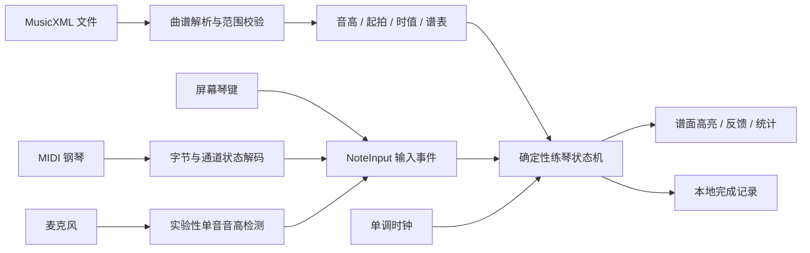

# 架构与数据流

## 代码结构

`Sources/PianoCore` 是无 UI、无网络依赖的 Swift 库，包含曲谱模型、MusicXML 解析、练琴状态机、MIDI 字节解码和单音音高检测。`Tests/PianoCoreTests` 用固定时间与已知音符做可重复测试。

`Sources/PianoApp` 是 SwiftUI 应用。Views 呈现实际引擎状态；PracticeViewModel 管理会话、计时、输入模式和本地记录。Services 负责 Core MIDI、AVAudioEngine 麦克风采样和节拍声。

## 数据流

## 时间与语义

曲谱统一使用四分音符为一拍，时间来自 MusicXML duration/divisions；界面 BPM 也是四分音符每分钟。Core MIDI 时间戳转换为主机单调时间。引擎注入时间，测试不依赖真实等待。

休止表示为起音间的空隙。相同起拍的音组成和弦组。延音线在导入时合并成一次起音，因此不会要求用户重复弹延音线终点。

识谱模式在音组完成后前进；节奏模式有独立时间轴，漏音只标记当前音，不把后续整段错位。按键时长与实际声音长度分开说明。

## 输入隔离

同一时刻只使用一个输入模式，MIDI 只连接一个所选来源，切换输入/设备会释放按键状态。设备事件在主线程修改 UI 模型。MIDI 回调首先复制原始数据，避免音频/驱动指针越界生命周期。

麦克风采样在本机分析，只有稳定的单音估计转换为事件。它不能可靠确认所有复音或同音连续起音，因此限定为实验识谱模式，不做节奏评分。音频不会写入库或上传。

## 平台策略

SwiftUI + Core MIDI + AVFoundation。iOS 使用 Xcode 工程，核心由本地 Swift Package 链接。macOS 使用 Swift Package executable 构建同一份界面，减少环境阻塞；它是开发预览，不取代 iOS 构建。

## 已知取舍

目前不依赖外部乐谱渲染库，使用原生 Canvas 展示简化练习谱。这个实现可以离线构建，完整排版、复杂连线/声部和出版级刻谱需要后续专门迭代，不能宣称与原始乐谱完全一致。
