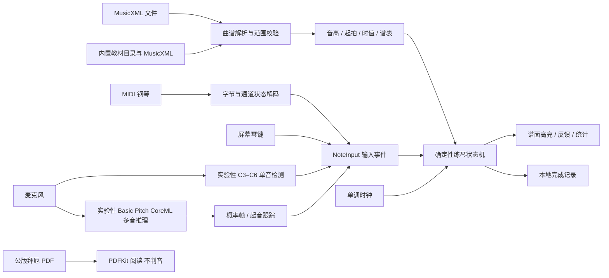

# 架构与数据流

## 代码结构

`Sources/QinXuCore` 是无 UI、无网络依赖的 Swift 库，包含曲谱模型、MusicXML 解析、练琴状态机、MIDI 字节解码、单音音高检测和多音概率帧到音符事件的纯状态跟踪器。`Tests/QinXuCoreTests` 用固定时间与已知音符做可重复测试。

`Sources/QinXuApp` 是 SwiftUI 应用。Views 提供曲库、搜索、详情、谱架、练习和真实记录；PracticeViewModel 管理会话、计时、输入模式和本地记录。Services 负责 Core MIDI、AVAudioEngine 生命周期、CoreML 推理、节拍声和呈现数据存储。

收藏与封面由 ScorePresentationStore 保存到独立的 `library.presentation.json`，不修改曲谱语义；图片先验证、降采样并移除元数据，写入失败保留原状态，损坏或不支持版本的文件先留恢复副本。

BundledPracticeLibrary 读取内置教材目录，使用同一 MusicXMLParser 解析课次，再交给同一练琴引擎。当前拜厄有 59 项中文重排练习，覆盖 39 首原曲；第 1、2 首主题和变奏分段，准确范围见[资源说明](../Sources/QinXuApp/Resources/Books/Beyer/README.txt)。目录或任一资源解析失败时整体报告错误，不展示不完整加载结果。课次采用稳定 ID；导入与保存路径均排除内置 ID，用户数据保留选曲、收藏、自选封面和完成记录，不把教材副本写入导入曲库。

BookPracticeView 提供课次搜索、详情和练习入口。BundledBook 与 PDFKit 阅读器另行提供 88 页外文公版原书参考；PDF 不进入判音引擎。中文练习谱不是出版社中文版，未宣称收录完整 106 首。用户没有小汤纸书，其完整电子谱仍未取得，不创建已内置内容。

## 数据流

## 时间与语义

曲谱统一使用四分音符为一拍，时间来自 MusicXML duration/divisions；界面 BPM 也是四分音符每分钟。Core MIDI 时间戳转换为主机单调时间。引擎注入时间，测试不依赖真实等待。

休止表示为起音间的空隙。相同起拍的音组成和弦组。延音线在导入时合并成一次起音，因此不会要求用户重复弹延音线终点。

识谱模式在音组完成后前进；节奏模式有独立时间轴，漏音只标记当前音，不把后续整段错位。按键时长与实际声音长度分开说明。多音麦克风关闭时长反馈，仅等待模式单独接受最多 3 秒的缓冲输入延迟；实时输入默认仍为 250 ms，节奏模式不能放宽。事件保留原采集时间，避免同一批到达的分开弹奏被误合并成和弦。

长音提示独立于起音判定：引擎按已接受音符的采集起点、谱面时值和当前 BPM 计算应保持音集合，PracticeViewModel 用单调时钟刷新。缓冲输入不会从收到结果的时刻重新计满时值；下一音前进或声学 off 不会提前清除谱面长音提示，暂停、重置和 allNotesOff 会清除。此提示不是实际按键/踏板状态，也不把余音当作新起音。

完成一遍后的循环重启时间取“一秒间隔”与“最后长音提示结束”两者较晚值。等待循环期间阻止新起音评分，但放行 off 和 velocity=0 释放事件；双手麦克风停止、暂停或切后台会取消待重启循环。完成记录仍每遍只保存一次。

PianoKeyboardRange 只根据整首曲谱与所选手计算带缓冲的固定音域，至少三八度，限于 MIDI 0–127。当前待弹音、声音和长音集合只改变颜色，不改变键位；宽度不足时允许水平滚动，不自动跟随下一音。实际按下/检测到声音优先显示橙色，谱面应保持音显示浅橙，绿色待弹标记可与长音同时存在。

## 输入隔离

同一时刻只使用一个输入模式，MIDI 只连接一个所选来源，切换输入/设备会释放按键状态。设备事件在主线程修改 UI 模型。MIDI 回调首先复制原始数据，避免音频/驱动指针越界生命周期。

单音与多音麦克风是独立服务。单音仍限制 C3–C6 逐音练习；多音使用未修改的 Basic Pitch CoreML 模型，按完整 88 音输出读取声学证据，不按谱面补音。固定容量缓冲保留约 2 秒连续音频，每 0.2 秒尝试最新窗口，最多一个推理任务。

多音采集使用 AVAudioTime 样本位置检查连续性和去重，将 hostTime 桥接至引擎的单调时钟；缺少可靠时间或出现丢段时停止。事件按采集时间稳定排序，暂停、切换、结束及中断通过 generation 和逐事件活动检查阻止旧缓冲继续评分。两种模式都在本机分析，音频不写入曲库或上传。

多音模型接入不等于质量验收。带 MIDI 真值的实录开发检查仍漏掉 383/882 个起音（±50 ms），不能视为可靠双手陪练或 iPad 准确率。模型许可、资源校验、时间规则和可复现实测见 [POLYPHONIC_MICROPHONE.md](POLYPHONIC_MICROPHONE.md)。

## 平台策略

SwiftUI + Core MIDI + AVFoundation + CoreML + PDFKit。iPhone 使用横屏，iPad 保留横竖屏。iOS 使用 Xcode 工程，核心由本地 Swift Package 链接。macOS 使用 Swift Package executable 构建同一份界面，减少环境阻塞；它是开发预览，不取代 iOS 构建。

首次克隆先运行 `bash scripts/prepare-resources.sh`，下载并校验固定版本模型、Bravura 字体和拜厄 PDF；这些二进制不提交 Git，许可与下载脚本保留。资源缺失时验证失败，不能以占位内容计为完成。

拜厄结构化练习谱、manifest、源文件哈希及核验摘要随源码保存。`python3 scripts/import-beyer-ranote.py --fetch --check` 按 source-lock 下载公开源数据，重建并核对生成结果；应用运行时不访问录谱网站。反复已在转换时按已核验顺序展开，不改变 MusicXML 导入器拒绝未支持反复结构的规则。

`Config/Signing.xcconfig` 提供共享应用标识并可选包含被忽略的 `LocalSigning.xcconfig`。`scripts/configure-ios-signing.py` 只配置公开 Team ID 与 Bundle ID，保留受管理块之外的本地设置，不保存凭证；重新生成工程不会覆盖个人配置。

2026-11-25 最新 `verify.sh --require-ios` 通过 107 项测试（65 项核心、42 项应用）及 iOS Simulator 目标构建，拜厄源数据重建核验通过。当前 59 项教材版本在 iPad 上的 6 项 XCTest UI 测试全部通过，xcresult 摘要确认、截图已导出；严格签名复核与恢复正常数据模式后的 `devicectl` 启动成功。触屏计分和琴键位置检查不代表目标 iPad 的实琴准确率、延迟或物理麦克风长音已验收，以 [STATUS.md](STATUS.md) 的实际证据为准。

## 已知取舍

使用原生 Canvas 和官方 Bravura 1.482（SIL-OFL）音乐 glyph 展示简化练习谱，覆盖谱号、拍号、音头、临时记号、符尾与附点。完成资源准备后可离线构建；完整排版、复杂连线/声部和出版级刻谱仍需专门迭代，不能宣称与原始乐谱完全一致。
